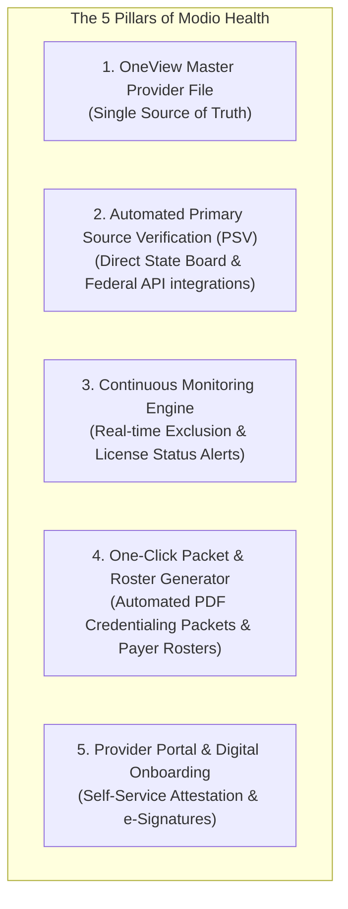
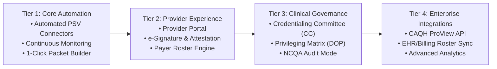
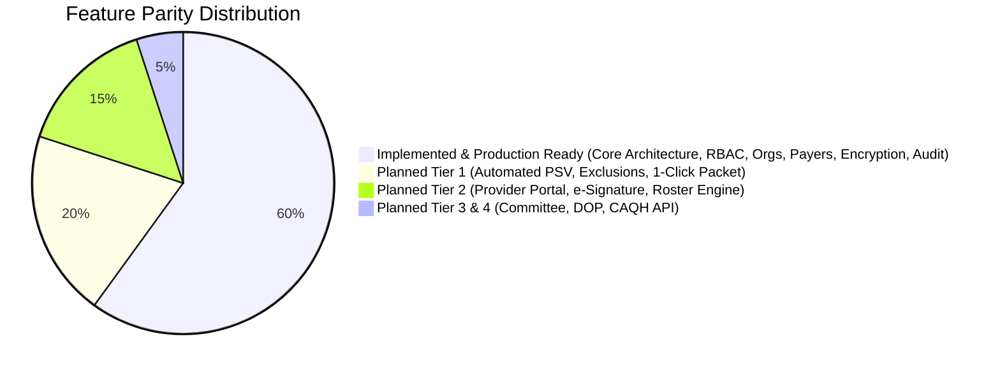

# Strategic Roadmap: Transforming Provider Credentialing into a Modio Health Equivalent

**Document Version:** 1.0  
**Target Milestone:** Comprehensive Modio Health / symplr Parity  
**Application Architecture:** Next.js 14 (App Router), Prisma, PostgreSQL 16, Redis 7, MinIO S3, BullMQ, Caddy  

---

## 1. Executive Vision: The Modio Health Benchmark

**Modio Health** (now a flagship component of *symplr*) is the healthcare industry benchmark for cloud-based credentialing, provider management, and payer enrollment. Its market success is built on 5 fundamental pillars:

Our current application has established a secure foundation (Phases 1–9 + Organization Management + Admin Management), featuring:
- AES-256-GCM encrypted Tax IDs and SSNs
- Append-only immutable PostgreSQL audit logs protected by database triggers
- Multi-role RBAC (`super_admin`, `admin`, `credentialing_specialist`, `enrollment_specialist`, `viewer`)
- MinIO S3 document storage with SHA-256 verification
- Group / Organization entity modeling with Primary affiliation logic
- Payer enrollment state machines with follow-up tracking and revalidation aging
- Coordinated backup and restore management

This roadmap defines the concrete architecture, data models, integration points, and workflows necessary to evolve this platform into a full Modio Health alternative.

---

## 2. Gap Analysis: Current System vs. Modio Health

| Capability Area | Modio Health Standard | Current System State | Priority Gap |
| :--- | :--- | :--- | :---: |
| **Primary Source Verification (PSV)** | Automated daily/weekly API and scraping connectors to NPPES, OIG-LEIE, SAM.gov, FSMB, DEA, state medical boards with verification PDF capture. | Manual verification history recording with user stamp; no external automated connectors. | **HIGH (Tier 1)** |
| **Continuous Monitoring** | Real-time alerts when a provider's license is disciplined or name appears on exclusion lists. | Date-based expiration alerts (e.g. 90/60/30/14 days) via BullMQ background jobs. | **HIGH (Tier 1)** |
| **Credentialing Packet Builder** | One-click compilation of application, verified credentials, licenses, COI, and PSV reports into a single bookmarked PDF. | Individual document downloads from MinIO; manual document gathering. | **HIGH (Tier 1)** |
| **Provider Self-Service Portal** | Provider login or magic link; mobile-friendly questionnaire; document upload; digital e-signature. | Specialist-entered onboarding form; no provider-facing self-service role. | **HIGH (Tier 2)** |
| **Committee & Privileging Workflows** | Digital Credentialing Committee (CC) agendas, voting packets, electronic voting, and facility delineation of privileges (DOP). | Provider `credentialingStatus` field (`in_progress`, `approved`, `pending_review`); no voting or privileging matrix. | **MEDIUM (Tier 3)** |
| **Payer Rostering** | Export multi-provider rosters formatted to specific payer specifications (BCBS, Medicare, Medicaid, Aetna, Cigna, UHC). | Generic CSV reports and work queue export; no payer-specific roster templates. | **MEDIUM (Tier 2)** |
| **CAQH & EHR Interoperability** | CAQH ProView bi-directional sync, NPPES API import, EHR sync (Epic, Cerner, Athena). | Free-text CAQH ID field; CSV bulk import; no live CAQH or NPPES API connector. | **MEDIUM (Tier 4)** |
| **NCQA / URAC Compliance** | Automated audit-ready compliance tracking (e.g., PSV within 120-day / 180-day window). | Immutability and audit logs present, but no dedicated NCQA audit report mode. | **MEDIUM (Tier 3)** |

---

## 3. Recommended Improvement Phases (Strategic Roadmap)

---

### Tier 1: Core Automation & Verification (Immediate Parity)

#### 1.1 Automated Primary Source Verification (PSV) Connectors
Modio eliminates manual verification by automatically scraping or calling federal and state APIs.
* **Integrations to Build:**
  1. **NPPES NPI Registry API (Free & Public):** Auto-populate provider name, taxonomy, enumeration date, practice address, and NPI Type 1 / Type 2 directly from CMS.
  2. **OIG-LEIE Exclusion List (Monthly Automated Sync):** Download and index the HHS Office of Inspector General exclusion database to automatically flag matches against provider NPI and SSN.
  3. **SAM.gov System for Award Management (API):** Query debarment and federal exclusion status.
  4. **DEA Registration Verification:** Automated query via US Department of Justice Diversion Control API or verification file check.
  5. **State Medical/Nursing Board Scrapers:** Headless browser or direct API workers for priority states (e.g. TX, CA, NY, FL) that capture full license status (Active, Probation, Revoked) and store a timestamped verification PDF in MinIO.
* **Architecture:**
  - Leverage existing Redis / BullMQ worker framework (`workers/runner.ts`).
  - Add scheduled jobs: `jobs:psv:exclusions`, `jobs:psv:license-sync`.
  - Save verification results into `VerificationHistory` with `verifiedBy: "SYSTEM_AUTOMATION"` and attach the generated proof PDF.

#### 1.2 One-Click Credentialing Application & Packet Builder
Credentialing coordinators spend hours compiling documents for committee or payer review. Modio solves this with instant packet compilation.
* **Implementation:**
  - Add `src/lib/packets/packet-generator.ts` using `pdf-lib` or `puppeteer-core`.
  - Automatically generate:
    1. Branded Cover Sheet (Provider Photo, NPI, Specialties, Contact Info).
    2. Executive Summary (Affiliated Organizations, Tax ID, Malpractice History).
    3. PSV Audit Trail (OIG, SAM, License, and DEA timestamps with status).
    4. Compiled Document Attachments (State licenses, Board Certs, DEA certificates, CV, COI merged in standard sequence with PDF bookmarks).
  - API endpoint: `POST /api/v1/providers/[id]/generate-packet`.
  - Store the compiled packet in MinIO with audit log tracking.

#### 1.3 Continuous Monitoring vs. Passive Expiration Alerts
Instead of waiting for an expiration date, continuous monitoring detects sanctions, revocations, and exclusions as they happen.
* **Implementation:**
  - Schedule nightly or weekly delta scans against state license databases and federal exclusion registries.
  - When a status change is detected (e.g., license status changes from "Active" to "Surrendered" or "Probation"):
    - Immediately escalate task priority to `CRITICAL`.
    - Trigger high-priority in-app and email notifications to compliance administrators.
    - Set provider status to `action_required`.

---

### Tier 2: Provider Self-Service & Enrollment Automation

#### 2.1 Provider Self-Service Portal (`provider` Role)
Modio allows providers to complete their own profiles and upload documents from mobile devices.
* **Implementation:**
  - Add `provider` to `UserRole` enum in Prisma schema.
  - Link `User` record to `Provider` entity (`User.providerId -> Provider.id`).
  - Provider Onboarding Invitation flow: Coordinator sends an invitation email containing a secure 72-hour magic-link token.
  - Provider UI:
    - Intuitive, mobile-responsive wizard (Personal Info, Education, Training, Licenses, Malpractice History, Disclosures).
    - Mobile document upload via camera / drag-and-drop.
    - Real-time onboarding completion progress bar (e.g. "Profile 85% Complete").

#### 2.2 Digital Disclosure & e-Signature Attestation
Accreditation bodies (NCQA, Joint Commission) require provider attestation regarding criminal history, substance abuse, and license suspensions.
* **Implementation:**
  - Add `Attestation` model storing:
    - 15 standard NCQA disclosure questions (Yes/No with explanatory text).
    - Digital signature representation (drawn signature or cryptographic click-to-sign).
    - Signer IP address, User-Agent, and ISO-8601 UTC timestamp.
    - SHA-256 hash of the signed document agreement text.
  - Export attestation as a tamper-evident signed PDF attached to the provider record.

#### 2.3 Automated Multi-Payer Roster Engine
Health systems must submit monthly or quarterly provider rosters to contracted health plans.
* **Implementation:**
  - Payer-specific roster templates (Excel/CSV):
    - **Medicare (CMS-855I / CMS-855R format mapping)**
    - **Medicaid State-specific roster grids**
    - **Commercial Payers (BCBS, Aetna, Cigna, UnitedHealthcare standardized roster format)**
  - Dynamic generation from active `ProviderOrganization` and `PayerEnrollment` data.
  - Export interface allowing specialists to select Organization + Payer &rarr; click **Generate Roster** &rarr; download pre-formatted `.xlsx` workbook.

---

### Tier 3: Clinical Governance & Privileging (Health Systems & Clinics)

#### 3.1 Credentialing Committee (CC) & Approval Workflow
For hospitals and surgery centers, the Credentialing Committee and Medical Executive Committee (MEC) are mandatory.
* **Implementation:**
  - **Committee Agenda Builder:** Group multiple pending provider files into a digital meeting agenda.
  - **Electronic Committee Review:** Committee members review packets and submit electronic votes (`Approve`, `Deny`, `Conditional`, `Tabled`) with review notes.
  - **Reappointment Cycle Tracker:** Automate the 24-month (2-year) NCQA / Joint Commission reappointment clock, initiating re-credentialing 150 days prior to expiration.

#### 3.2 Delineation of Privileges (DOP) Forms & Facility Matrix
* **Implementation:**
  - Privilege catalog organized by specialty (e.g., General Surgery, Cardiology, Family Practice).
  - Core Privileges vs. Special / Advanced Privileges (requiring case logs and proctoring documentation).
  - Facility Privileging Status: `Active`, `Provisional`, `Temporary`, `Suspended`.

#### 3.3 NCQA & URAC Audit-Ready Compliance Reporting
* **Implementation:**
  - Automated compliance scanner checking:
    - PSV verification age (&le; 120 or 180 days prior to committee approval).
    - Medical malpractice claim history verified within window.
    - Continuous work history gap analysis (flags gaps &gt; 60 days).
    - Signed attestation age (&le; 180 days).
  - Generates a 1-click **NCQA Audit Dossier** demonstrating 100% compliance.

---

### Tier 4: Enterprise Interoperability & Platform Extensibility

#### 4.1 CAQH ProView Direct Connect API
* Bi-directional synchronization with CAQH ProView API to ingest updated provider attestations, eliminating duplicate data entry for providers.

#### 4.2 EHR & Practice Management Webhooks
* Webhooks for events: `provider.approved`, `provider.expired`, `enrollment.active`.
* Sync active provider roster to EHR (Athena, Epic, Cerner) to update billing provider master files.

---

## 4. Suggested Implementation Blueprint: Next Immediate Steps

To achieve maximum value quickly while building toward the Modio vision, we recommend sequencing the next enhancements in 3 focused packages:

### Package A: Automated Primary Source Verification (NPPES + OIG/SAM)
1. Add NPPES Registry API integration for instant NPI lookup during provider onboarding (auto-fills taxonomy, names, addresses).
2. Add OIG-LEIE and SAM.gov exclusion database scanning background job in BullMQ.
3. Automatically log verification checks and flag exclusions.

### Package B: One-Click Credentialing Packet Generator
1. Implement PDF packet merger using `pdf-lib`.
2. Generate branded cover sheet, credential summary, PSV verification proof, and attached MinIO documents.
3. Downloadable from Provider Profile with one click.

### Package C: Provider Self-Service Onboarding & Attestation
1. Create `provider` user role and onboarding magic-link invitation workflow.
2. Build mobile-first provider onboarding wizard with document upload and NCQA disclosure attestation.

---

## 5. Summary Matrix: Current Baseline vs. Modio Target

The foundation already built in this codebase—with strict PostgreSQL immutability, AES-256-GCM encryption, full Docker isolation, and rich many-to-many group/payer data models—provides the exact enterprise-grade architecture required to support these advanced Modio Health capabilities.
